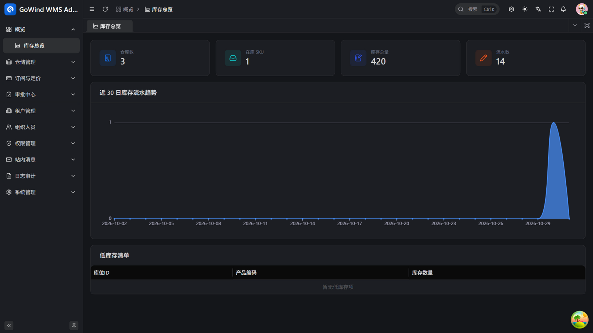
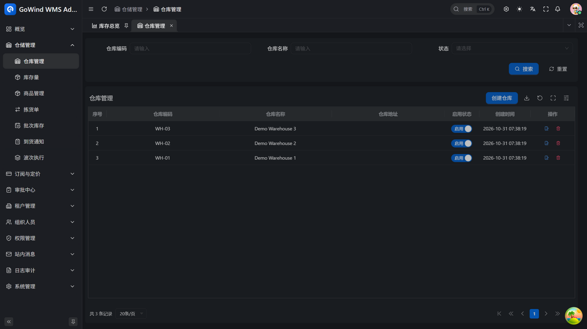
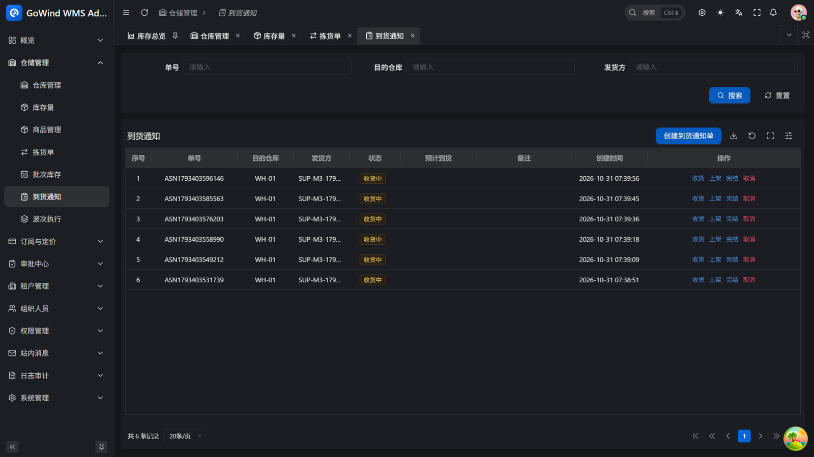
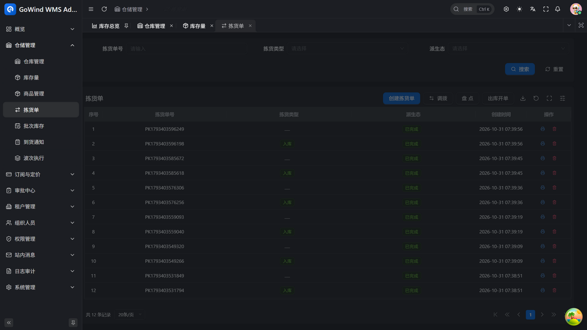
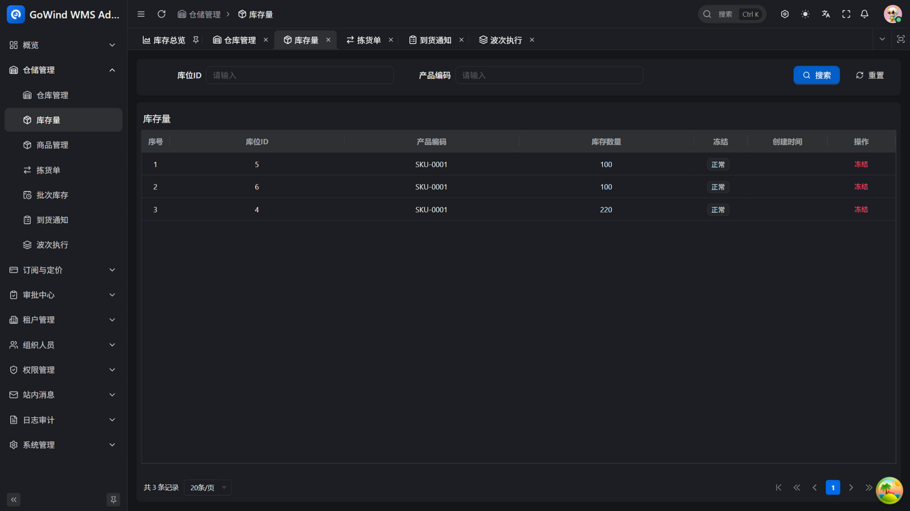
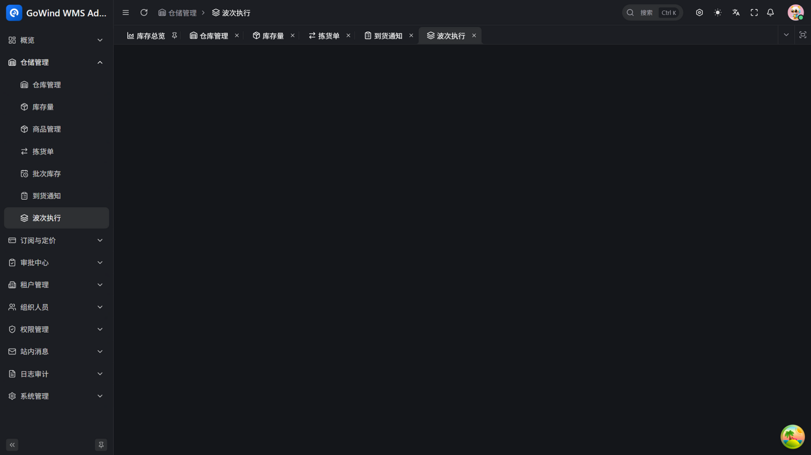

<div align="center">


# GoWind WMS

[](./LICENSE)

**English** | [中文](./README.md) | [日本語](./README.ja-JP.md)

</div>

---

Warehouses, stock, and floor operations — the core of small 3PL, e-commerce, and factory-finished-goods warehouses — run as one system: multi-owner stock isolation, bin-level management, inbound/outbound movements (state machine + server-verified write-back), cross-warehouse transfers (single-transaction atomic), and idempotent stock reversal. Data is entered once and flows everywhere. No implementation consultants, no months-long rollout.

**GoWind WMS in three sentences:**

- **No implementation consultants** — Sign up and go: tenant, departments, roles, and admin are initialized automatically; permissions, approvals, internal messaging, and audit are all built in
- **Up and running in half a day** — Admin console plus mobile PDA out of the box; the core flows — transfer, cycle count, stock verification — work from day one, with barcode scanning on the floor and a stock dashboard for management
- **Books always match the floor** — Odoo-style stock.quant/picking/move modeling: every stock change leaves a move-line execution record; quantity and cost are written back inside one transaction, fully traceable

Developers are well served too: API-first (RESTful / gRPC dual protocol with auto-generated OpenAPI docs), microservices, and native i18n — see the [Tech Stack](#tech-stack) below.

## Project Status

GoWind WMS is derived from the inventory module and common foundation of GoWind ERP (the same proven multi-tenant / permission / audit / approval-rail skeleton). **The open-source feature set is complete and verified by end-to-end smoke tests**:

- ✅ **M1 Inbound** — ASN booking → announce → receiving (over-receipt blocked) → putaway, with PDA barcode scanning
- ✅ **M2 Outbound** — direct outbound orders → confirm → validate (FEFO lot deduction) → wave execution (single failure never blocks)
- ✅ **M3 Inventory Operations** — lot expiry management (FEFO by real expiry), stock freeze (outbound blocked), aging report (30/60/90/180+ buckets)
- ✅ Common foundation — multi-tenancy, org & permissions, approval rail, audit, SaaS subscription quota, zh/en/ja i18n, dual-protocol API (RESTful / gRPC)

Key consistency logic (over-receipt / oversell guards, transfer atomicity, lot ledger integrity) is covered by regression tests and end-to-end smoke runs.

## Screenshots

| | |
|:---:|:---:|
|  |  |
| *Stock dashboard* | *Warehouse management* |
|  |  |
| *ASN (receive / putaway / close)* | *Pickings (transfer / count / outbound)* |
|  |  |
| *Stock quants & freeze* | *Wave execution* |

## Commercial Roadmap

The open-source edition focuses on the core warehouse operations loop. The following capabilities are planned for the commercial edition (closed source):

- Billing engine — multi-owner storage/handling fees & reconciliation (the open edition keeps the billing_event hook interface)
- Third-party adapters — shipping labels, Kuaidi100, Cainiao, SF Bridge, GPS platforms
- Blind-count orchestration, QC / handover stations, WCS device integration

> Roadmap: M1 inbound (ASN → receiving → QC → putaway) → M2 outbound (wave → picking → packing → handover) → M3 inventory operations (cycle count, freeze, snapshot, aging reports) → M4 multi-owner billing → M5 third-party integrations (shipping labels etc.) → M6 demo site & official release.

## Core Features

### Organization & Permissions

| Feature | Description |
|:---|:---|
| Multi-tenant Management | Tenant creation, enable/disable & data isolation; auto-init departments, roles & admin |
| User Management | Full lifecycle management, multi-role/dept/position binding |
| Role Management | Role & role group management with menu, API & data permissions |
| Permission Management | Permission groups, menu nodes & permission points, policy-engine-driven authorization, button-level control |
| Menu Management | Visual menu config with directory/page/button levels, dynamic rendering by permission |
| Department & Position Management | Multi-level department trees and position hierarchies with user binding |
| Authentication & Login Policy | JWT issuance & validation, login policy config, credential & token cache management |

### System & Operations

| Feature | Description |
|:---|:---|
| Audit Logs | Full-link audit of login, operation, API call, data access, permission change & policy evaluation — operator, IP, params & results |
| File Management | Unified upload/download to local or object storage, preview & grouping |
| Dictionary Management | Data dictionary categories & items with linked multilingual translation |
| Internal Messaging | Multi-level message categories, targeted delivery & read-status tracking, personal inbox |
| Task Scheduling | Cron job management, start/pause/execute, execution history & logs |
| Multi-language Management | Language management, unified translation for content, menus & UI text |

### WMS Business Modules

| Module | Description |
|:---|:---|
| ASN (Inbound) | Booking → announce → batch receiving (over-receipt blocked by row-level conditional updates) → QC gate → putaway grouped by target location, PDA barcode scanning |
| Stock Engine | quant (location×product unique) + move (state machine) + move-line (execution record) + lot (batch/expiry), moving-average cost, dual-track virtual locations |
| Direct Outbound | Outbound orders created directly (consignee + lines), confirm → validate in a single transaction, atomic negative-stock-guarded deduction |
| FEFO Lot Deduction | Unassigned outbound picks auto-split lots by expiry ascending; 409 on shortage; expiry recorded at receiving |
| Wave Execution | Multiple confirmed outbound pickings executed as one wave (single failure never blocks, retryable, auto-completion) |
| Stock Freeze | Frozen quants cannot be deducted by outbound (counting/transfers unaffected), one-click freeze/unfreeze |
| Aging Report | On-hand quantity bucketed by last inbound time (30/60/90/180+ days), filterable by warehouse |
| Executive Dashboard | Warehouse count / SKU count / total stock / movement count / low-stock list / 30-day trend |
| Subscription & Quota | Plan catalog + tenant subscription + read-only on expiry + monthly order/user quota guard |
| Approval Rail (generic) | Generic approval skeleton (multi-level flows, self-approval blocked, in-app notification on resolution) |
| Mobile business features | PDA scanning: receive/putaway, outbound confirm/validate, approval center, executive dashboard |


## Tech Stack

[](https://go.dev/)
[](https://vuejs.org/)
[](https://flutter.dev/)
[](https://go-kratos.dev/)

### Backend

| Layer | Technology | Description |
|:---|:---|:---|
| Language | [Go 1.25+](https://go.dev/) | High-performance compiled language |
| Framework | [go-kratos](https://go-kratos.dev/) | Microservice framework |
| DI | Hand-written assembly (`wiring.go`) | No DI framework; `make register` assists module registration |
| ORM | [Ent](https://entgo.io/) | Go entity framework |
| Database | [PostgreSQL](https://www.postgresql.org/) | Relational database |
| Cache | [Redis](https://redis.io/) | In-memory data store |
| Object Storage | [MinIO](https://min.io/) | S3-compatible object storage |
| Service Registry | [Etcd](https://etcd.io/) | Service discovery & configuration |
| Tracing | [Jaeger](https://www.jaegertracing.io/) + [OpenTelemetry](https://opentelemetry.io/) | Distributed observability |
| API Definition | [Protobuf](https://protobuf.dev/) + [buf.build](https://buf.build/) | Contract-first API design |

### Admin Frontend

| Technology | Description |
|:---|:---|
| [Vue 3](https://vuejs.org/) | Progressive frontend framework |
| [TypeScript](https://www.typescriptlang.org/) | Type-safe development |
| [Ant Design Vue](https://antdv.com/) | Enterprise UI component library |
| [Vben Admin](https://doc.vben.pro/) | Admin management framework |

### Mobile Frontend

| Version | Tech Stack | Use Case |
|:---|:---|:---|
| Flutter | [Flutter](https://flutter.dev/) + [BLoC](https://bloclibrary.dev/) | Cross-platform native app |

## Project Structure

```
go-wind-wms/
├── backend/                        # Backend services
│   ├── api/                        # Protobuf API definitions & generated code
│   │   ├── protos/                 # .proto source files
│   │   └── gen/                    # Generated code (Go / Dart / OpenAPI)
│   ├── app/
│   │   ├── admin/service/          # Admin BFF (HTTP/gRPC)
│   │   ├── app/service/            # Mobile BFF (HTTP/gRPC)
│   │   └── core/service/           # Core service (business logic + data layer)
│   ├── pkg/                        # Shared packages (auth/crypto/eventbus/JWT/middleware/OSS...)
│   └── scripts/                    # Deploy scripts (Docker/env setup)
├── frontend/
│   ├── admin/                      # Admin frontend (Vue3 + Ant Design Vue + Vben Admin)
│   └── app/
│       └── flutter_app/            # Mobile app (Flutter cross-platform native)
└── LICENSE
```

## Quick Start

### Prerequisites

- Go 1.25+
- Docker & Docker Compose
- Node.js 18+ & pnpm
- Flutter SDK
- buf (Protobuf toolchain)

### 1. Start Dependencies

```bash
cd backend

# Windows
.\scripts\docker\libs_only.ps1

# Linux / macOS
./scripts/docker/libs_only.sh
```

### 2. Start Backend

```bash
# Recommended: use gow CLI
gow run admin
gow run app
```

### 3. Start Frontend

```bash
# Admin panel
cd frontend/admin
pnpm install
pnpm dev

# Mobile app (Flutter)
cd frontend/app/flutter_app
flutter pub get
flutter run
```

### Common Commands

```bash
cd backend

# Generate Protobuf API code
make api

# Generate OpenAPI docs
make openapi

# Generate all code (ent + api + openapi)
make gen

# Build all services
make build

# Run tests
make test
```

> For more development workflows, see [Backend Docs](./backend/README.md) and [Scripts Guide](./backend/scripts/WORKFLOWS_AND_BEST_PRACTICES.md).

## Contact

- WeChat: `yang_lin_bo` (Note: `go-wind-wms`)

## Contributing

We welcome all forms of contribution, including but not limited to:

- Submit [Issues](../../issues) to report bugs or suggest features
- Submit [Pull Requests](../../pulls) to fix issues or add features
- Improve documentation and translations
- Share your experience

## License

This project is licensed under the [MIT License](./LICENSE).

## Acknowledgements

[](https://jb.gg/OpenSource)

Thanks to [JetBrains](https://jb.gg/OpenSource) for providing free GoLand & WebStorm open source licenses.
