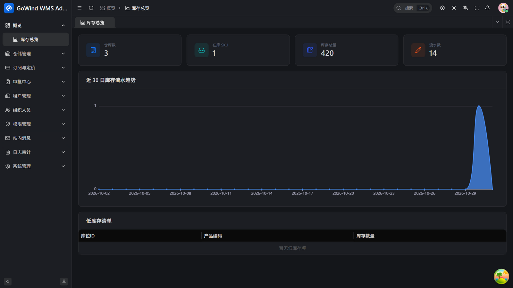
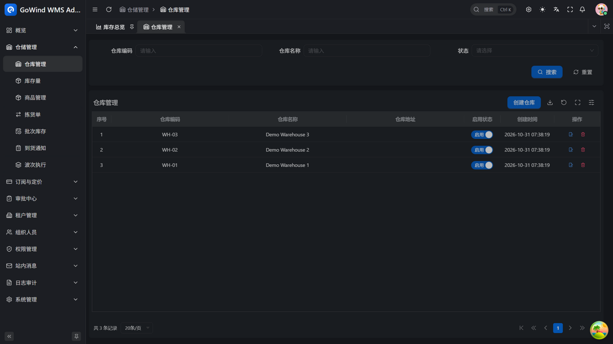
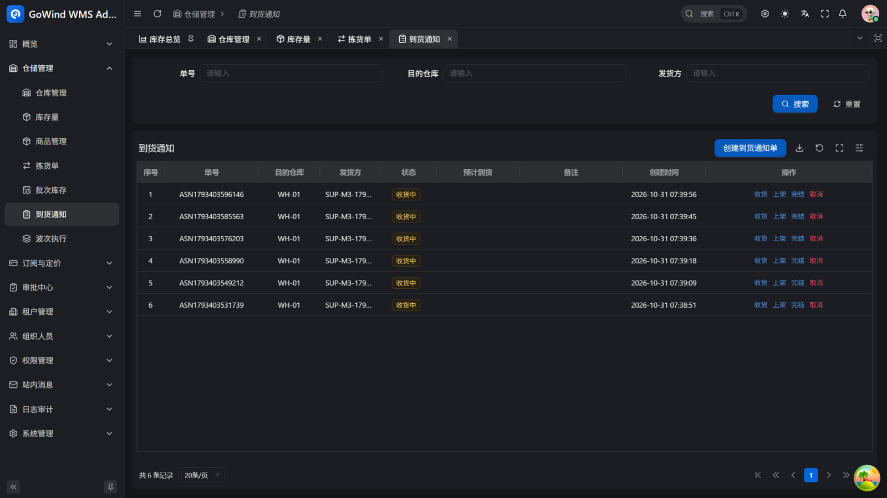
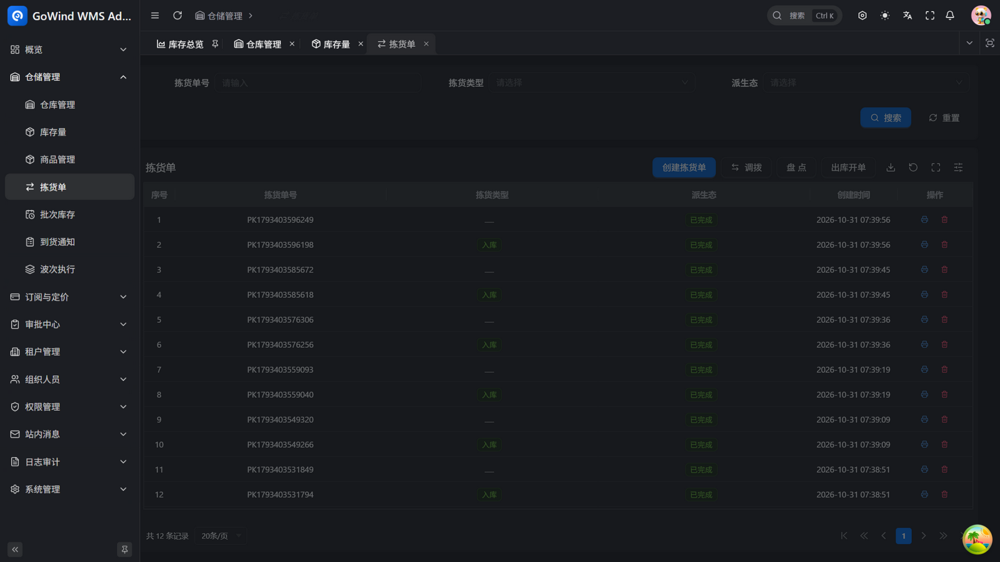
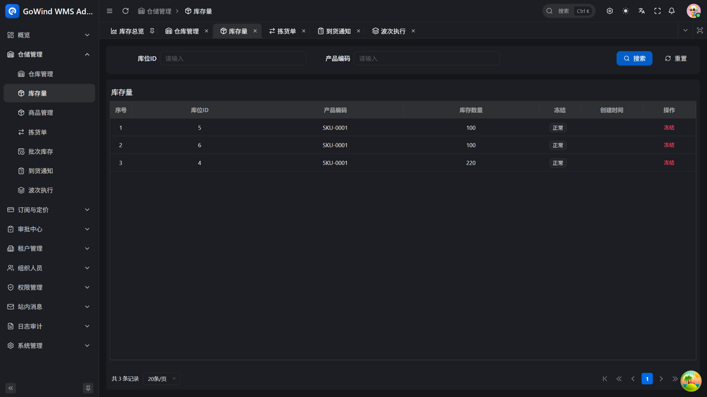
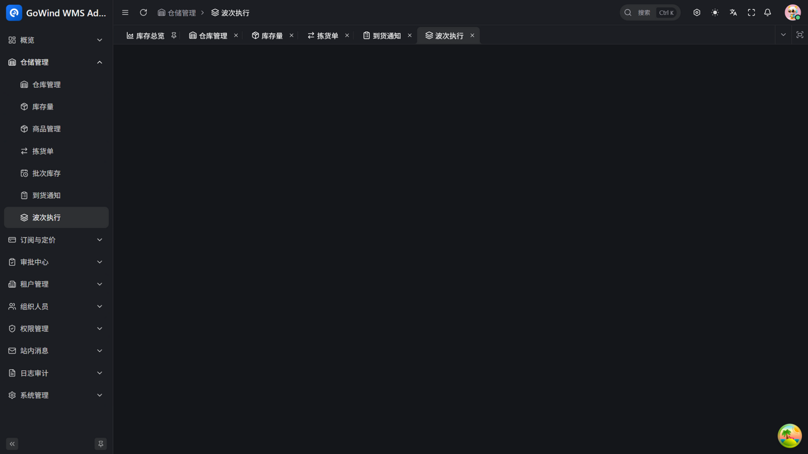

<div align="center">


# GoWind WMS

[](./LICENSE)

[English](./README.en-US.md) | [中文](./README.md) | **日本語**

</div>

---

倉庫・在庫・現場作業——小規模 3PL・EC・工場完成品倉庫の核心を、ひとつのシステムで閉じます。オーナー別の在庫分離、ロケーション単位の管理、入出庫移動（状態機械 + サーバー検証の書き戻し）、倉庫間転送（単一トランザクションで原子的実行）、冪等な在庫取消。データは一度入力すれば全体に行き渡ります。導入コンサルタントも、長い導入期間も不要です。

**GoWind WMS を 3 文で：**

- **導入コンサルタント不要** — 登録すればすぐ開始：テナント・部門・ロール・管理者は自動初期化、権限・承認・サイト内メッセージ・監査などの基盤機能をすべて内蔵
- **半日で使い始められる** — 管理コンソールとモバイル PDA を同梱。転送・棚卸・在庫照合のコアフローがそのまま動き、倉庫の現場はバーコードスキャンで、経営層は在庫ダッシュボードで
- **帳簿と現場は常に一致** — Odoo 流の stock.quant/picking/move モデリング：すべての在庫変動には move-line の実行記録が残り、数量とコストは同一トランザクション内で書き戻され、完全に追跡可能

開発者にも扱いやすい設計：API ファースト（RESTful / gRPC デュアルプロトコル、OpenAPI ドキュメント自動生成）、マイクロサービス、ネイティブ多言語対応——詳しくは下記の[テクノロジースタック](#テクノロジースタック)を参照してください。

## プロジェクトの状況

GoWind WMS は GoWind ERP の在庫モジュールと汎用基盤から派生しました（実績のあるマルチテナント / 権限 / 監査 / 承認レールのスケルトンを継承）。**オープンソース版の機能は完成し、E2E スモークテストで検証済みです**：

- ✅ **M1 入庫** — ASN 予約 → 告知 → 受入（過剰受入ブロック）→ 棚入、PDA バーコード作業
- ✅ **M2 出庫** — 出庫直発 → 確認 → 検証（FEFO ロット控除）→ ウェーブ実行（単一失敗は非ブロック）
- ✅ **M3 在庫運用** — ロット有効期限管理（実効期による FEFO）、在庫凍結（出庫ブロック）、エイジングレポート（30/60/90/180+ 日）
- ✅ 汎用基盤 — マルチテナント、組織権限、承認レール、監査、SaaS サブスクリプション割当、中日英 i18n、デュアルプロトコル API

主要な整合性ロジック（過剰受入/過剰出荷ガード、転送の原子性、ロット台帳整合性）は回帰テストと E2E スモークでカバーされています。

## スクリーンショット

| | |
|:---:|:---:|
|  |  |
| *在庫ダッシュボード* | *倉庫管理* |
|  |  |
| *入荷予定（受入/棚入/完了）* | *ピッキング（転送/棚卸/出庫）* |
|  |  |
| *在庫量と凍結* | *ウェーブ実行* |

## 商用版ロードマップ

オープンソース版は倉庫コア作業ループに焦点を当てています。以下は商用版（クローズドソース）で計画されている機能です：

- 課金エンジン — オーナー別保管料/作業料/精算（オープン版は billing_event フックを提供）
- サードパーティアダプタ — 送り状、Kuaidi100、菜鳥、SF Bridge、GPS
- 盲目棚卸オーケストレーション、検品/引渡しステーション、WCS 連携

> ロードマップ：M1 入庫（ASN → 受入 → 検品 → 納品方法）→ M2 出庫（ウェーブ → ピッキング → 梱包 → 引き渡し）→ M3 在庫運用（循環棚卸、フリーズ、スナップショット、エイジングレポート）→ M4 オーナー別課金 → M5 サードパーティ連携（送り状など）→ M6 デモサイト & 正式リリース。

## コア機能

### 組織 & 権限

| 機能 | 説明 |
|:---|:---|
| マルチテナント管理 | テナントの追加、有効化/無効化、データ分離。新規テナントの部門、ロール、管理者を自動初期化 |
| ユーザー管理 | ライフサイクル全体を管理、複数ロール/部署/役職のバインディング |
| ロール管理 | ロール & ロールグループ管理、メニュー/API/データ権限の設定 |
| 権限管理 | 権限グループ、メニューノード、権限ポイント、ポリシーエンジンによる認可、ボタンレベルの制御 |
| メニュー管理 | ディレクトリ/ページ/ボタンの 3 レベル設定、権限に基づく動的レンダリング |
| 部門 & 役職管理 | 複数レベルの部門ツリーと役職階層、ユーザーとの連携バインディング |
| 認証 & ログインポリシー | JWT の発行と検証、ログインポリシー設定、資格情報 & トークンキャッシュ管理 |

### システム & 運用

| 機能 | 説明 |
|:---|:---|
| 監査ログ | ログイン、操作、API 呼び出し、データアクセス、権限変更、ポリシー評価の全リンク監査 — 操作者、IP、パラメータ & 結果を記録 |
| ファイル管理 | ローカルまたはオブジェクトストレージへの統一アップロード/ダウンロード、プレビュー & グループ管理 |
| 辞書管理 | データ辞書カテゴリ & アイテム、連携する多言語翻訳 |
| サイト内メッセージ | 複数レベルのメッセージカテゴリ、対象配送 & 既読ステータス追跡、個人受信トレイ |
| タスクスケジューリング | Cron ジョブ管理、開始/一時停止/即時実行、実行履歴 & ログ |
| 多言語管理 | 言語管理、コンテンツ/メニュー/UI テキストの統一翻訳 |

### WMS 業務モジュール

| モジュール | 説明 |
|:---|:---|
| 入荷予定（ASN） | 予約 → 告知 → 分割受入（過剰受入を行レベル条件更新でブロック）→ 検品ゲート → 棚入（目標ロケーション別グループ）、PDA バーコード作業 |
| 在庫エンジン | quant（ロケーション×製品ユニーク）+ move（状態機械）+ move-line（実行記録）+ lot（ロット/有効期限）、移動平均コスト、デュアルトラック仮想ロケーション |
| 出庫直発 | 出庫伝票直接作成（引取先+明細）、確認 → 単一トランザクション検証、負在庫ガード付き原子控除 |
| FEFO ロット控除 | 指定なしの出庫は有効期限昇順でロット自動分割、不足時 409、受入時に有効期限記録 |
| ウェーブ実行 | 複数の確認済出庫伝票を一括実行（単一失敗は非ブロック、再試行可能、自動完了） |
| 在庫凍結 | 凍結行は出庫控除不可（棚卸/転送は影響なし）、ワンクリック凍結/解除 |
| エイジングレポート | 最終入庫時点で在庫数量をバケット化（30/60/90/180+ 日）、倉庫フィルタ対応 |
| 経営ダッシュボード | 倉庫数 / SKU 数 / 在庫総量 / 移動数 / 低在庫リスト / 30 日トレンド |
| サブスクリプション & 割当 | プランカタログ + テナント契約 + 期限切れリードのみ + 月次伝票/ユーザー割当ガード |
| 承認レール（汎用） | 汎用承認スケルトン（多段フロー、自己承認禁止、承認結果をサイト内通知） |
| モバイル業務機能 | PDA スキャン：受入/棚入、出庫確認/検証、承認センター、経営ダッシュボード |


## テクノロジースタック

[](https://go.dev/)
[](https://vuejs.org/)
[](https://flutter.dev/)
[](https://go-kratos.dev/)

### バックエンド

| レイヤー | 技術 | 説明 |
|:---|:---|:---|
| 言語 | [Go 1.25+](https://go.dev/) | 高性能コンパイル言語 |
| フレームワーク | [go-kratos](https://go-kratos.dev/) | マイクロサービスフレームワーク |
| DI | 手書きアセンブリ (`wiring.go`) | DI フレームワークなし。`make register` が登録を補助 |
| ORM | [Ent](https://entgo.io/) | Go エンティティフレームワーク |
| データベース | [PostgreSQL](https://www.postgresql.org/) | リレーショナルデータベース |
| キャッシュ | [Redis](https://redis.io/) | インメモリデータストア |
| オブジェクトストレージ | [MinIO](https://min.io/) | S3 互換オブジェクトストレージ |
| サービスレジストリ | [Etcd](https://etcd.io/) | サービスディスカバリ & 設定管理 |
| トレーシング | [Jaeger](https://www.jaegertracing.io/) + [OpenTelemetry](https://opentelemetry.io/) | 分散オブザーバビリティ |
| API 定義 | [Protobuf](https://protobuf.dev/) + [buf.build](https://buf.build/) | コントラクトファースト API 設計 |

### 管理コンソールフロントエンド

| 技術 | 説明 |
|:---|:---|
| [Vue 3](https://vuejs.org/) | プログレッシブフロントエンドフレームワーク |
| [TypeScript](https://www.typescriptlang.org/) | 型安全開発 |
| [Ant Design Vue](https://antdv.com/) | エンタープライズ UI コンポーネントライブラリ |
| [Vben Admin](https://doc.vben.pro/) | 管理画面フレームワーク |

### モバイルフロントエンド

| バージョン | 技術スタック | 用途 |
|:---|:---|:---|
| Flutter | [Flutter](https://flutter.dev/) + [BLoC](https://bloclibrary.dev/) | クロスプラットフォームネイティブアプリ |

## プロジェクト構造

```
go-wind-wms/
├── backend/                        # バックエンドサービス
│   ├── api/                        # Protobuf API 定義 & 生成コード
│   │   ├── protos/                 # .proto ソースファイル
│   │   └── gen/                    # 生成コード (Go / Dart / OpenAPI)
│   ├── app/
│   │   ├── admin/service/          # 管理用 BFF (HTTP/gRPC)
│   │   ├── app/service/            # モバイル用 BFF (HTTP/gRPC)
│   │   └── core/service/           # コアサービス (ビジネスロジック + データ層)
│   ├── pkg/                        # 共通パッケージ (認可/暗号化/イベントバス/JWT/ミドルウェア/OSS...)
│   └── scripts/                    # デプロイスクリプト (Docker/環境設定)
├── frontend/
│   ├── admin/                      # 管理コンソールフロントエンド (Vue3 + Ant Design Vue + Vben Admin)
│   └── app/
│       └── flutter_app/            # モバイルアプリ (Flutter クロスプラットフォームネイティブ)
└── LICENSE
```

## クイックスタート

### 前提条件

- Go 1.25+
- Docker & Docker Compose
- Node.js 18+ & pnpm
- Flutter SDK
- buf (Protobuf ツールチェーン)

### 1. 依存サービスの起動

```bash
cd backend

# Windows
.\scripts\docker\libs_only.ps1

# Linux / macOS
./scripts/docker/libs_only.sh
```

### 2. バックエンドの起動

```bash
# 推奨：gow CLI を使用
gow run admin
gow run app
```

### 3. フロントエンドの起動

```bash
# 管理コンソール
cd frontend/admin
pnpm install
pnpm dev

# モバイルアプリ (Flutter)
cd frontend/app/flutter_app
flutter pub get
flutter run
```

### よく使うコマンド

```bash
cd backend

# Protobuf API コードの生成
make api

# OpenAPI ドキュメントの生成
make openapi

# 全コードの生成 (ent + api + openapi)
make gen

# 全サービスのビルド
make build

# テストの実行
make test
```

> 開発ワークフローの詳細は [バックエンドドキュメント](./backend/README.md) と [スクリプトガイド](./backend/scripts/WORKFLOWS_AND_BEST_PRACTICES.md) を参照してください。

## お問い合わせ

- WeChat 個人アカウント：`yang_lin_bo`（備考：`go-wind-wms`）

## コントリビューション

以下のような貢献を歓迎します：

- [Issue](../../issues) の提出：バグ報告や機能提案
- [Pull Request](../../pulls) の提出：修正や新機能の追加
- ドキュメントや翻訳の改善
- 利用経験の共有

## ライセンス

このプロジェクトは [MIT License](./LICENSE) の下で公開されています。

## 謝辞

[](https://jb.gg/OpenSource)

[JetBrains](https://jb.gg/OpenSource) から無料の GoLand & WebStorm オープンソースライセンスを提供していただき、感謝いたします。
