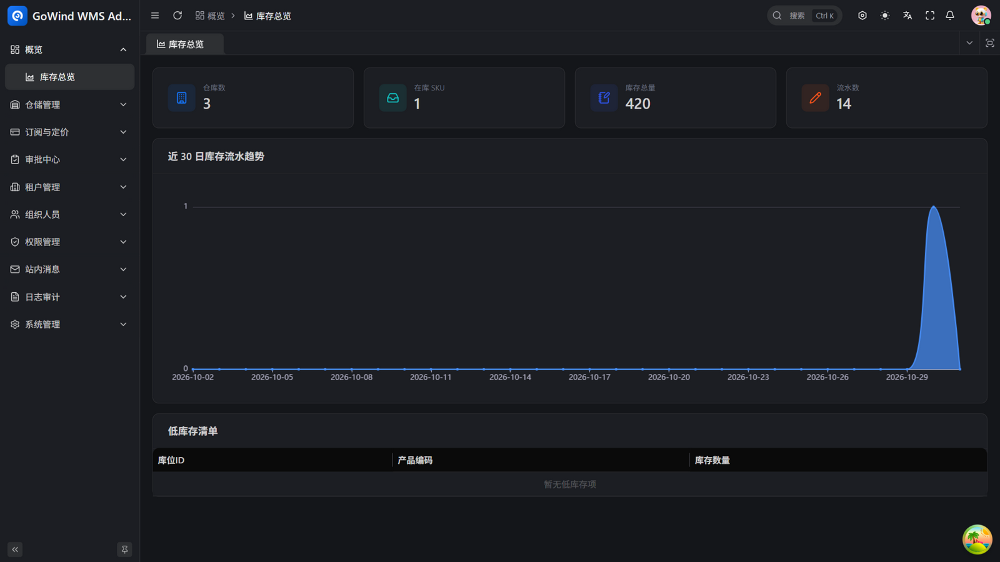
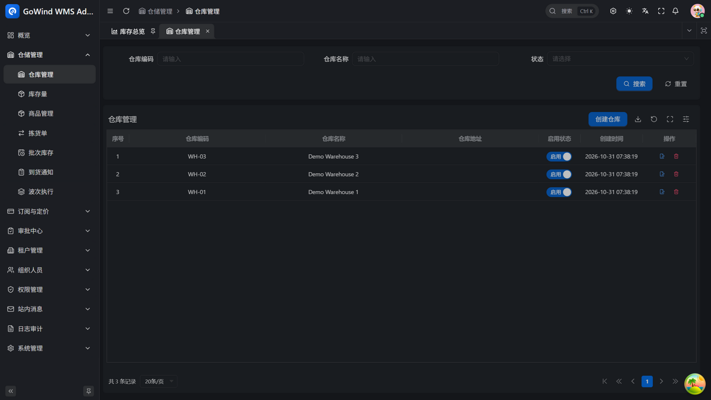
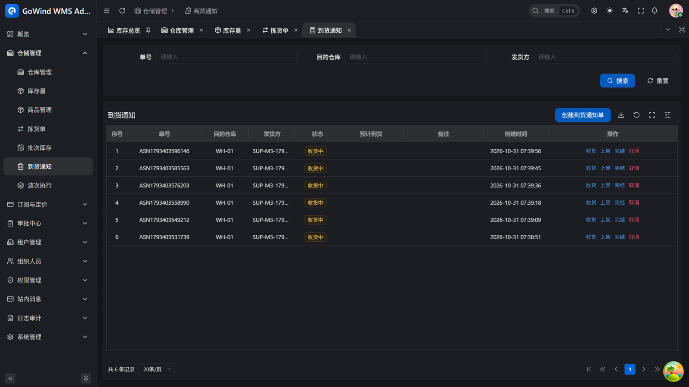
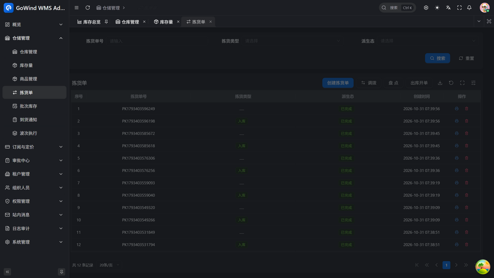
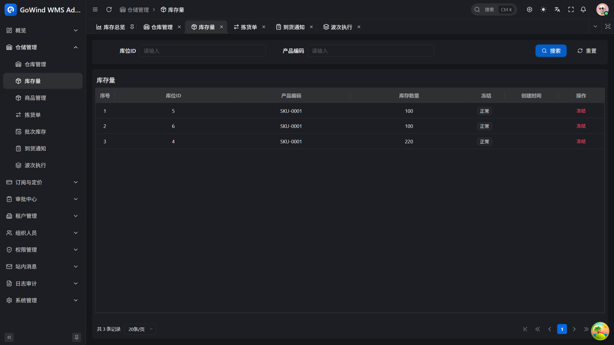
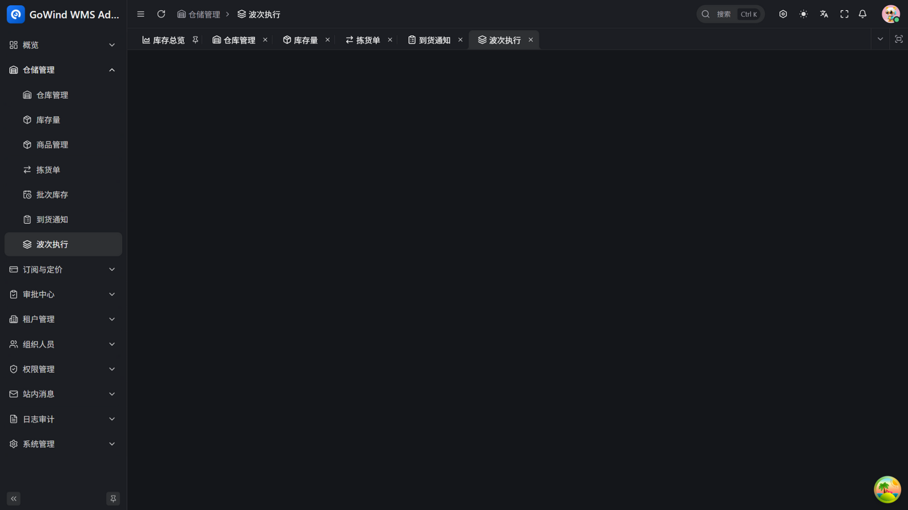

<div align="center">


# GoWind WMS

[](./LICENSE)

[English](./README.en-US.md) | **中文** | [日本語](./README.ja-JP.md)

</div>

---

仓库、库存、作业——中小 3PL 仓、电商仓、工厂成品仓最核心的现场业务，在同一个系统里闭环：多货主库存隔离、库位级管理、出入库流水（状态机 + 服务端校验）、跨仓调拨（单事务原子执行）、库存冲正（幂等防重复）。数据一次录入、处处生效，不需要实施顾问，也不需要漫长的实施周期。

**三句话讲清楚 GoWind WMS：**

- **免实施顾问** — 注册即开通：租户、部门、角色、管理员自动初始化，权限、审批、站内消息、审计等基座能力全部内置，开箱即用
- **半天上手** — 管理后台 + 手机 PDA 双端齐备，调拨、盘点、库存核对的核心链路开箱即走；仓库现场用扫码，管理层看库存看板
- **库存账实一致** — 借鉴 Odoo stock.quant/picking/move 建模：每笔库存变动都有 move-line 执行记录，数量与成本在事务内同步回写，随时可追溯

对开发者同样友好：API 优先（RESTful / gRPC 双协议，OpenAPI 文档自动生成）、微服务架构、原生多语言——技术细节见下方[技术栈](#技术栈)。

## 项目状态

GoWind WMS 基于 GoWind ERP 的库存模块与通用基座衍生而来（同一套经过验证的多租户 / 权限 / 审计 / 审批轨骨架）。**开源版功能已完整落地并通过端到端冒烟验收**：

- ✅ **M1 入库链** — 到货通知单（ASN）预约 → 宣告 → 收货（防超收）→ 上架，PDA 扫码作业
- ✅ **M2 出库链** — 出库直发开单 → 确认 → 校验（FEFO 批次扣减）→ 波次合并执行（单张失败不阻塞）
- ✅ **M3 库存运营** — 批次效期管理（FEFO 按真实效期先扣）、库存冻结（出库拦截）、库龄报表（30/60/90/180+ 分桶）
- ✅ 通用基座 — 多租户、组织权限、审批轨、审计、订阅配额（SaaS）、中英日三语、双协议 API（RESTful / gRPC）

关键一致性逻辑（防超收、防超卖、调拨事务原子性、批次账目自洽）均有回归测试与端到端冒烟覆盖。

## 界面预览

| | |
|:---:|:---:|
|  |  |
| *库存总览看板* | *仓库管理* |
|  |  |
| *到货通知（收货/上架/完结）* | *拣货单（调拨/盘点/出库开单）* |
|  |  |
| *库存量与冻结* | *波次执行* |

## 商业版路线图

开源版聚焦仓库核心作业闭环。以下能力规划在商业版（闭源）：

- 计费引擎 — 多货主仓储费/操作费/对账账单（开源版保留 billing_event 事件埋点接口）
- 第三方对接适配器 — 电子面单、快递 100、菜鸟、丰桥、GPS 平台
- 盲盘编排、复核/交接台、WCS 设备对接

> 路线图：M1 入库链（ASN 预约 → 收货 → 质检 → 上架策略）→ M2 出库链（波次 → 拣货 → 复核 → 交接）→ M3 库存运营（循环盘点、冻结、快照、库龄报表）→ M4 多货主计费 → M5 第三方对接（电子面单等）→ M6 演示站与正式发布。

## 核心功能

### 组织与权限

| 功能        | 说明                                                |
|:----------|:--------------------------------------------------|
| 多租户管理     | 租户新增、启用/禁用与数据隔离；新租户自动初始化部门、角色与管理员 |
| 用户管理      | 用户全生命周期管理，支持多角色、多部门、多岗位绑定         |
| 角色管理      | 角色与角色分组管理，配置菜单、接口与数据权限           |
| 权限管理      | 权限分组、菜单节点与权限点，策略引擎驱动鉴权，按钮级控制 |
| 菜单管理      | 可视化菜单配置，目录/页面/按钮三级，按权限动态渲染      |
| 部门与岗位管理   | 多级部门树与岗位体系，联动绑定用户                |
| 认证与登录策略   | JWT 签发与校验、登录策略配置、凭据与令牌缓存管理      |

### 系统与运维

| 功能      | 说明                                          |
|:--------|:--------------------------------------------|
| 审计日志    | 登录、操作、接口调用、数据访问、权限变更、策略评估全链路审计，记录操作人、IP、参数与结果 |
| 文件资源管理  | 本地或对象存储统一上传/下载，预览与分组管理            |
| 字典管理    | 数据字典大类与子项管理，多语言翻译联动               |
| 站内消息    | 多级消息分类，定向投递与已读状态追踪，个人消息中心      |
| 任务调度    | 定时任务管理，启动/暂停/立即执行，查看执行记录与日志    |
| 多语言管理   | 语种管理，内容、菜单、提示信息统一翻译            |

### WMS 业务模块

| 模块          | 说明                              |
|:------------|:----------------------------------|
| 到货通知（ASN） | 预约 → 宣告 → 分批收货（防超收，行级条件更新）→ 质检闸门 → 上架（按目标库位分组），PDA 扫码作业 |
| 库存引擎      | quant（库位×产品 唯一）+ move（状态机）+ move-line（执行记录）+ lot（批次/效期），加权平均成本，双轨虚拟位置 |
| 出库直发      | 出库单直接创建（客户 + 明细），确认 → 校验单事务落账，防负库存原子扣减 |
| FEFO 批次扣减 | 出库无指派时按效期升序自动拆分批次，余量不足 409；收货登记效期 |
| 波次执行      | 多张已确认出库单合并执行（单张失败不阻塞、可重试、自动完结） |
| 库存冻结      | 冻结行不可出库扣减（盘点/调拨不受限），一键冻结/解冻 |
| 库龄报表      | 在库数量按最近入库时间分桶（30/60/90/180+ 天），支持仓库过滤 |
| 经营看板      | 仓库数 / SKU 数 / 库存总量 / 流水数 / 低库存清单 / 30 天流水趋势 |
| 订阅与配额     | 套餐目录 + 租户订阅 + 到期只读 + 本月单量/用户数配额守卫 |
| 审批轨（通用）    | 通用审批骨架（多级流程、禁自审自批、审结站内信通知），供业务单据挂接 |
| 移动端业务功能    | PDA 扫码：收货/上架、出库确认/校验、审批中心、经营看板 |


### ERP 业务模块

| 模块          | 说明                              |
|:------------|:----------------------------------|
| 库存 / WMS    | 仓库与库存管理（状态机）、出入库流水（服务端校验回写）、跨仓调拨（单事务原子执行）、流水冲正（幂等防重复）、低库存自动补货建议（经审批轨生成草稿采购单）、经营看板聚合与 30 天流水趋势 |
| 采购 / SRM    | 供应商管理、采购单全生命周期（草稿→提交→审批→驳回重提→收货→全额自动完结/取消）、按明细收货回写（审批闸门 + 防超收） |
| 财务 / AP     | 应付单（采购单获批自动生成）、付款申请（经审批轨入账）、部分付款与结清状态机、应付账龄报告 |
| 审批轨（通用）    | 采购单 / 付款 / 补货三类单据统一审批；申请人与审批人由服务端推导，禁止自审自批，审结站内信通知申请人，补货草稿创建与采购单自动完结触发下游通知 |
| 移动端业务功能    | WMS 扫码（出入库 / 调拨 / 冲正）、审批中心、经营看板 |

## 技术栈

[](https://go.dev/)
[](https://vuejs.org/)
[](https://flutter.dev/)
[](https://go-kratos.dev/)

### 后端

| 层级     | 技术                                                                     | 说明            |
|:-------|:-------------------------------------------------------------------------|:--------------|
| 语言     | [Go 1.25+](https://go.dev/)                                             | 高性能编译型语言    |
| 框架     | [go-kratos](https://go-kratos.dev/)                                     | 微服务框架       |
| 依赖注入   | 手写装配（wiring.go）                                                                  | 无 DI 框架，`make register` 辅助登记 |
| ORM    | [Ent](https://entgo.io/)                                                | Go 实体框架      |
| 数据库    | [PostgreSQL](https://www.postgresql.org/)                               | 关系型数据库       |
| 缓存     | [Redis](https://redis.io/)                                              | 内存数据库       |
| 对象存储   | [MinIO](https://min.io/)                                                | 兼容 S3 的对象存储 |
| 服务注册   | [Etcd](https://etcd.io/)                                                | 服务发现与配置      |
| 链路追踪   | [Jaeger](https://www.jaegertracing.io/) + [OpenTelemetry](https://opentelemetry.io/) | 分布式可观测       |
| API 定义 | [Protobuf](https://protobuf.dev/) + [buf.build](https://buf.build/)     | 接口契约优先       |

### 管理后台前端

| 技术                                            | 说明         |
|:----------------------------------------------|:-----------|
| [Vue 3](https://vuejs.org/)                   | 渐进式前端框架    |
| [TypeScript](https://www.typescriptlang.org/) | 类型安全       |
| [Ant Design Vue](https://antdv.com/)          | 企业级 UI 组件库 |
| [Vben Admin](https://doc.vben.pro/)           | 后台管理框架     |

### 移动端前端

| 版本      | 技术栈                                 | 适用场景       |
|:--------|:-------------------------------------|:-----------|
| Flutter | [Flutter](https://flutter.dev/) + [BLoC](https://bloclibrary.dev/) | 跨平台原生应用 |

## 项目结构

```
go-wind-wms/
├── backend/                        # 后端服务
│   ├── api/                        # Protobuf API 定义 & 生成代码
│   │   ├── protos/                 # .proto 源文件
│   │   └── gen/                    # 生成代码 (Go / Dart / OpenAPI)
│   ├── app/
│   │   ├── admin/service/          # 管理后台 BFF (HTTP/gRPC)
│   │   ├── app/service/            # 移动端 BFF (HTTP/gRPC)
│   │   └── core/service/           # 核心服务 (业务逻辑 + 数据层)
│   ├── pkg/                        # 公共包 (鉴权/加密/事件总线/JWT/中间件/OSS...)
│   └── scripts/                    # 部署脚本 (Docker/环境安装)
├── frontend/
│   ├── admin/                      # 管理后台前端 (Vue3 + Ant Design Vue + Vben Admin)
│   └── app/
│       └── flutter_app/            # 移动端应用 (Flutter 跨平台原生)
└── LICENSE
```

## 快速开始

### 环境要求

- Go 1.25+
- Docker & Docker Compose
- Node.js 18+ & pnpm
- Flutter SDK
- buf (Protobuf 工具链)

### 1. 启动依赖服务

```bash
cd backend

# Windows
.\scripts\docker\libs_only.ps1

# Linux / macOS
./scripts/docker/libs_only.sh
```

### 2. 启动后端服务

```bash
# 推荐方式：使用 gow CLI
gow run admin
gow run app
```

### 3. 启动前端

```bash
# 管理后台
cd frontend/admin
pnpm install
pnpm dev

# 移动端 (Flutter)
cd frontend/app/flutter_app
flutter pub get
flutter run
```

### 常用命令

```bash
cd backend

# 生成 Protobuf API 代码
make api

# 生成 OpenAPI 文档
make openapi

# 一键生成全部代码 (ent + api + openapi)
make gen

# 构建所有服务
make build

# 运行测试
make test
```

> 更多开发工作流请参考 [后端文档](./backend/README.md) 和 [脚本指南](./backend/scripts/WORKFLOWS_AND_BEST_PRACTICES.md)。

## 联系我们

- 微信个人号：`yang_lin_bo`（备注：`go-wind-wms`）

## 参与贡献

我们欢迎各种形式的贡献，包括但不限于：

- 提交 [Issue](../../issues) 报告 Bug 或提出功能建议
- 提交 [Pull Request](../../pulls) 修复问题或添加新功能
- 完善文档和翻译
- 分享使用经验

## 开源许可

本项目基于 [MIT License](./LICENSE) 开源。

## 致谢

[](https://jb.gg/OpenSource)

感谢 [JetBrains](https://jb.gg/OpenSource) 提供的免费 GoLand & WebStorm 开源许可。
